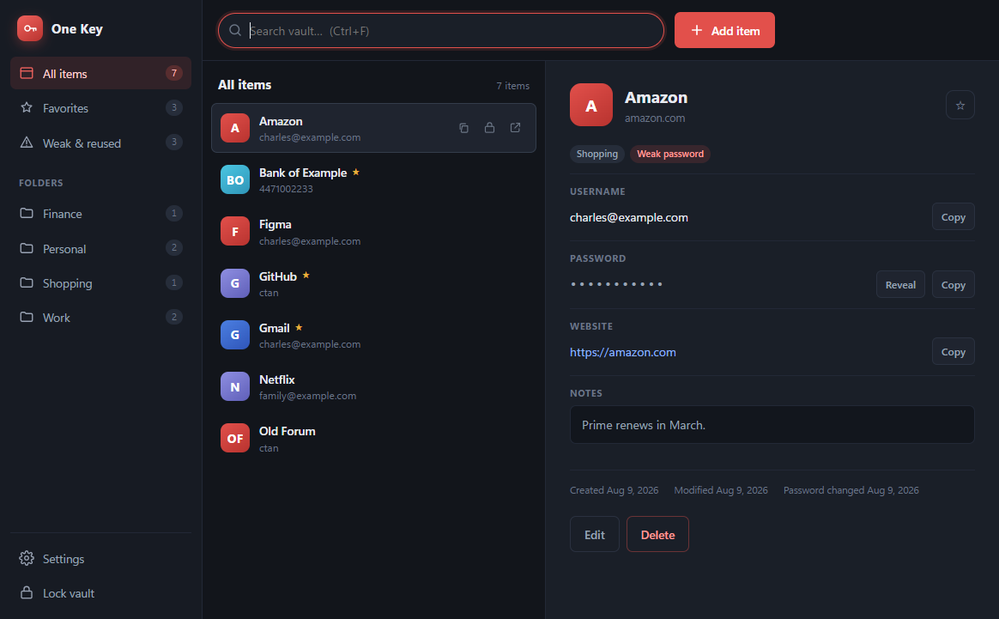

# One Key

A local-only password manager for Windows, in the spirit of LastPass — sidebar,
searchable item list, detail panel — but with no account, no sync, and no server.
Everything lives in one encrypted file on your machine.



## Running it

On first launch you'll be asked to create a master password. That password is the
only key to your vault: it is never stored anywhere, and there is no recovery
path. If you forget it, the data is gone.

### As a standalone app

```bash
npm run dist
```

That produces two self-contained builds in `dist\` — neither needs Node, npm, or
this source folder present to run:

| | |
|---|---|
| `One Key Setup 1.0.0.exe` | Installer. Lets you pick the folder, installs per-user (no admin prompt), and adds Desktop and Start Menu shortcuts. |
| `One Key 1.0.0 portable.exe` | Single file, no installation. Runs from anywhere — a USB stick, a synced folder. |

Both bundle their own Chromium, so each is about 76 MB.

The portable build unpacks itself to a temp folder on each launch, but its *vault*
still lives in `%APPDATA%` like the installed build — so your passwords persist
between runs, and the two builds share one vault.

Neither exe is code-signed, so Windows SmartScreen will warn the first time you
run it ("Windows protected your PC" → *More info* → *Run anyway*). Removing that
warning needs a paid code-signing certificate; nothing in the app can suppress it.

### From source

```bash
npm start
```

The crypto and vault layer has a test suite that runs on plain Node — no window,
no Electron:

```bash
npm test
```

## What it does

**Items** — name, username, password, website, folder, notes, favorite. Add, edit,
delete, search across every field.

**Views** — All items, Favorites, Weak & reused, plus a folder per folder name you
type. Folders are created implicitly; there's nothing to manage.

**Password generator** — length 8–64, toggles for character classes, and an option
to skip look-alike characters (`Il1O0o`) for passwords you may have to read aloud.
Reachable three ways:

- **Password generator** in the sidebar, or `Ctrl+G` — a standalone dialog. Every
  change to the options produces a new password, so what you see always matches
  the settings. **Copy** puts it on the clipboard with the usual auto-clear;
  **Save as new item** opens the editor prefilled with it. The password exists
  only in that dialog until you do one of those, and is cleared when it closes.
- **Generate** inside the add/edit form, when you're already creating an item.
- **In the browser, while registering** — see below.

Passwords come from `crypto.randomBytes` with rejection sampling, so there is no
modulo bias, and at least one character from every selected class is guaranteed.

**Strength meter** — an entropy estimate shown as you type, with penalties for
common passwords, keyboard runs, digit-only strings, low character variety, and
the `Word2024!` shape. It's a heuristic, not a cracking simulation: it has no
wordlist, so a memorable phrase like `MyDogIsNamedRex` scores better than a real
attacker would allow. Treat it as a nudge, not a verdict.

**Copy with auto-clear** — copying a password wipes the clipboard 30 seconds
later, and only if the clipboard still holds what One Key put there, so it never
clobbers something you copied yourself.

**Runs in the background** — closing the window hides One Key to the notification
area next to the clock rather than quitting. That matters for the Chrome
extension: the bridge only exists while the vault is unlocked, so a closed window
that also ended the process would take autofill with it.

Left-click the tray icon to reopen. Right-click for **Open One Key**, **Lock
vault**, and **Quit One Key** — quitting is explicit, and only from there or the
app menu. The tooltip and menu show whether the vault is currently unlocked.

Idle auto-lock still applies while hidden, so leaving it in the tray does not
leave the vault open indefinitely.

**Auto-lock** — after 1/5/15/30 minutes of no mouse or keyboard activity, or never.
Locking discards the encryption key from memory; unlocking re-derives it.

**Import and export** — encrypted backups, in and out. No plaintext, either
direction. See [Import and export](#import-and-export).

**Chrome integration** — fill logins into pages and capture new ones back into the
vault. See [Chrome integration](#chrome-integration) for how it works and how to
set it up.

**About** — app name, version, creator, copyright, and the Electron/Chromium/Node
versions it's running on. Reachable from the sidebar, or from *One Key → About One
Key* in the menu bar, which also works while the vault is locked. The version is
read from the running app rather than hardcoded, so it can't drift from
`package.json`.

### Keyboard

| | |
|---|---|
| `Ctrl+F` | focus search |
| `Ctrl+N` | add item |
| `Ctrl+G` | password generator |
| `Ctrl+L` | lock vault |
| `Ctrl+C` | copy selected item's password |
| `↑` / `↓` | move through the list |
| `Enter` / `Esc` | submit / close dialog |
| double-click | edit an item |

## Import and export

Both live behind **Import & export** in the sidebar, above Settings. They move the
whole vault rather than adjusting a preference, so they are an action of their own
rather than a setting.

One format, both directions: One Key's own encrypted backup. There is no
plaintext support at all — none written, and none read.

### Export

**Export encrypted backup…** writes a `.onekey` file encrypted under a password
you choose — scrypt and AES-256-GCM, the same envelope as the vault itself, with
its own random salt. Safe to keep on a spare drive or in cloud storage: without
that password the file is noise.

The backup password can differ from your master password. It is also
unrecoverable, so if the backup matters, so does remembering it.

If Google Drive for desktop (or the legacy Backup and Sync) is installed, the
save dialog opens straight into your Drive folder — it's detected by looking
for a synced `My Drive`/`Google Drive` folder, no Google sign-in or API access
involved. You still pick the exact file name and confirm the save yourself.

### Import

**Import encrypted backup…** takes a One Key `.onekey` file and asks for the
password it was saved with. Anything that is not a backup envelope is refused
outright rather than parsed.

### Why no plaintext, in either direction

A file holding every password in readable form is the worst artifact this app
could touch. Once one exists it outlives the intention behind it — it gets synced,
backed up and search-indexed, and it cannot be un-leaked. No warning dialog makes
that safe.

Refusing to *write* one while happily *reading* one would be half a policy: it
would still have users producing plaintext exports from other tools and leaving
them on disk. So both halves are gone, and the code paths do not exist to be
misused — no CSV writer, no CSV parser, nothing behind a flag.

**The trade this makes, stated plainly:** there is no bulk migration path into or
out of One Key. Moving in from Chrome, LastPass or Bitwarden means adding entries
by hand (the Chrome extension will offer to save each login as you next sign in,
which does most of the work for you). Moving out means reading them out of the app.
Backups cover the cases that actually matter day to day — losing the machine,
moving to a new one — and they stay encrypted throughout.

**Imports only ever add.** An entry identical to something already stored is
skipped; anything else becomes a new entry. Nothing is overwritten, ever — a
duplicate can be deleted afterwards, but a password overwritten by a bad merge is
gone. So importing the same backup twice is harmless, and re-importing an old one
after changing a password gives you both, not a silent downgrade.

Duplicate detection ignores `www.` and username capitalisation, and collapses
repeats inside a single file. You're told what happened: *"Imported 12 items · 3
already present"*.

## Chrome integration

A Chrome extension fills saved logins into pages and offers to save new ones back
into the vault. Chrome never receives your vault — it asks for one credential at a
time, and the app re-checks that the entry really belongs to the page before
answering.

### Setting it up

Two steps, both per-user and both reversible.

**1. Register the bridge:**

```bash
powershell -ExecutionPolicy Bypass -File tools\setup-chrome.ps1
```

This writes one registry value under `HKCU` and a manifest under
`%LOCALAPPDATA%\One Key`. No admin rights, nothing machine-wide. Undo with
`-Remove`.

**2. Load the extension** — open `chrome://extensions`, turn on **Developer mode**
(top right), choose **Load unpacked**, and select the `extension` folder. In an
installed copy that folder is `resources\extension` inside the install directory.

Developer mode is not optional: since Chrome 137 an unpacked extension stays
disabled without it, and it fails silently — installed, listed, but never running.

Then open One Key and unlock. The extension is live while the vault is unlocked.

### If the popup says "locked or not running" while the app is unlocked

The popup prints the technical reason in small grey text underneath. That line is
the whole diagnosis:

| Reason shown | What it means |
|---|---|
| `HOST_UNAVAILABLE — Specified native messaging host not found.` | Chrome could not find the registration. Re-run `setup-chrome.ps1`, then restart Chrome. If the `HKCU` key is demonstrably present and correct, see the policy note below. |
| `HOST_UNAVAILABLE — Access to the specified native messaging host is forbidden.` | The loaded extension's id is not the pinned one. Check the id on `chrome://extensions` against `nofckpbcfemncfcodiedbngfgobfkgok` and reload it from the `extension` folder. |
| `APP_NOT_RUNNING` | The app really is closed or locked, or **Settings → Browser integration** is off. |
| `TIMEOUT` | The relay started but the app never answered. |

**Managed Chrome profiles.** A profile signed in to a work Google account can carry
the `NativeMessagingUserLevelHosts` policy set to `false`, which makes Chrome
ignore `HKCU` hosts completely — reported as "host not found", identical to having
no registration at all. Check `chrome://policy`; `chrome://management` says whether
the profile is managed. The fix is a machine-level registration, from an elevated
prompt:

```bash
powershell -ExecutionPolicy Bypass -File tools\setup-chrome.ps1 -Machine
```

That writes to `HKLM` and `%ProgramData%\One Key` instead, which stays honoured.
If `chrome://policy` instead shows `NativeMessagingBlocklist` covering this host
(or `*`), the organisation blocks native messaging outright and no local change
will help — use a Chrome profile that isn't managed.

### Using it

Click a username or password field and a One Key chip appears at its edge. Click
the chip to see the logins saved for that site, and click one to fill. The toolbar
popup does the same thing from outside the page.

There is deliberately **no autofill on page load**. A hidden or off-screen form
could otherwise harvest a credential without you ever seeing it, so every fill
starts with your click.

### Registering for something new

On a signup form the panel leads with **Suggested password** instead of a list of
saved logins. **Use it** fills the password box and its confirmation; **Another**
asks for a different one. Submit the form and the usual save prompt offers to
store it, so a new account goes from generated to saved without leaving the page.

A field counts as a *new* password when the page declares
`autocomplete="new-password"`, when its name or label reads like a confirmation,
when a second password box is present, or when the surrounding form talks about
signing up.

The confirmation fill is deliberately narrow: it only touches other password boxes
that are themselves marked `new-password` or look like a confirm field. On a
change-password form there is also a *current* password box, and filling that with
the new value would be actively harmful.

Generation asks the app for the password rather than doing it in the extension, so
there is one generator with one audited random source — and the browser never
holds the generator's settings or logic.

When you sign in with a password the vault doesn't have, a prompt offers to save
it; when you change one, it offers to update. Saves store only the origin —
`https://example.com`, never the path or query string you happened to submit from.

An existing entry's password is only replaced when the **host and username both
match exactly**. Anything else becomes a new entry, so a browser-side mistake can
never quietly overwrite a different credential.

Every fill and save raises a notice in the app itself. A password manager that
hands out credentials silently gives you no way to notice one you didn't ask for.

Turn the whole thing off in **Settings → Browser integration**.

### How it fits together

```
Chrome
  extension  (service worker, content script, popup)
     |  native messaging: stdio, 32-bit length-prefixed JSON
  onekey-host.exe        small console relay, holds no keys
     |  named pipe, newline JSON, token from bridge.json
  One Key app            the only process that can decrypt anything
```

`onekey-host.exe` exists because Electron cannot be a native messaging host: its
main process never wires up `stdin` (it is a dummy stream that ends immediately),
and it writes a stray CRLF to `stdout` during startup, which Chrome reads as the
start of a length prefix and then kills the host. A console-subsystem binary has
neither problem and starts in milliseconds instead of booting a second Electron.
It is ~9 KB of C#, built by `tools\build-host.ps1` with the compiler that ships
with Windows — no toolchain to install, and `npm run dist` builds it for you.

The bridge only exists while the vault is unlocked: the app publishes
`vault\bridge.json` (pipe name plus a random token) on unlock and deletes it on
lock. So a locked vault is unreachable from the browser by construction rather
than by a check — which is also why the extension says "locked or not running"
rather than guessing between the two.

The pipe API is deliberately narrow. It can list matches for a URL without
passwords, hand over one credential for a URL it verifies, classify a save, apply
a save, and generate a fresh password. There is no call that exports the vault.

**The honest limit:** a named pipe is reachable by any process running as you, and
so is the token file guarding it. That adds no defence against a same-user
attacker — but such an attacker could already read the app's memory, where the
decrypted vault lives, so the bridge does not widen the threat model below. What
the token does buy is refusing lower-integrity processes that cannot read it, and
preventing accidental cross-talk.

Domain matching is hostname equality plus dot-boundary suffixes, so a `google.com`
entry offers itself on `accounts.google.com` while `evilgoogle.com` matches
nothing. It is not a Public Suffix List, so it still over-matches across
multi-label suffixes — an entry for `foo.github.io` will be offered on
`bar.github.io`. The result is one extra item in a list you choose from, never a
silent fill.

The scheme matters too: a login saved for an https site (or with no scheme, which
counts as https) is never offered on the plain-`http://` version of that site,
since anyone on the network can serve that page. `localhost` development servers
are exempt.

## How it's secured

| | |
|---|---|
| Key derivation | scrypt, N=2¹⁷, r=8, p=1, 32-byte key, 32-byte random salt |
| Encryption | AES-256-GCM, fresh 96-bit nonce per save |
| Integrity | GCM auth tag — a modified vault file fails to decrypt rather than loading corrupt data |
| Writes | temp file → `fsync` → previous file copied to `.bak` → atomic rename |

The derived key exists only in the main process and is zeroed on lock. The
renderer never receives it, and never receives the entry list with passwords
attached — it asks for one plaintext password at a time, only when you reveal,
copy, or edit an item.

The window runs with `contextIsolation`, `sandbox`, and no Node integration. Its
Content-Security-Policy blocks all remote loads, and the main process refuses
navigation, new windows, and `webview` attachment. Links open in your real browser
and only if they're `http`/`https`.

### What this does not protect against

Local threats, mostly. While the vault is unlocked the plaintext is in this
process's memory, so anything running as you — a keylogger, a debugger, a memory
dump — can read it. There's no protection against a compromised machine, and the
scrypt cost is tuned for a ~0.2s unlock, which is a real but bounded brute-force
cost on a stolen vault file. Use a long master password.

## Your data

The vault is a single file:

```
%APPDATA%\One Key\vault\vault.onekey
```

with `vault.onekey.bak` beside it holding the previous save. Copy the folder and
you've backed up your vault; the copy is useless without your master password.
Nothing is transmitted anywhere — the app makes no network requests at all.

### Uninstalling deliberately keeps your vault

Uninstalling removes the program and the Chrome bridge registration, but **not**
your vault. That is on purpose, not an oversight:

- The master password is the only key and there is no recovery path. If uninstall
  wiped the vault, reinstalling to upgrade — or an uninstall you later regretted —
  would destroy every password permanently.
- What stays behind is encrypted. Without your master password the file is noise,
  so leaving it is not a disclosure.

The folder also accumulates Chromium cache subdirectories; only `vault\` matters.

**When you do want it gone** — selling the machine, handing it on, starting over —
use the purge tool. It reports what it would remove and changes nothing until you
pass `-Force`:

```bash
powershell -ExecutionPolicy Bypass -File tools\purge-data.ps1
```

```bash
powershell -ExecutionPolicy Bypass -File tools\purge-data.ps1 -Backup D:\safe -Force
```

It clears the vault, both Chrome registrations, and both host manifests. Run it
elevated to also remove the machine-level registry key. It refuses to run while
One Key is still open. **A purged vault cannot be recovered** — use `-Backup` if
there is any doubt.

## Layout

```
src/
  main.js              Electron main: window, IPC, clipboard, external links
  preload.js           the only renderer↔main bridge; every channel listed
  crypto.js            scrypt KDF, AES-256-GCM envelope, password generator
  vault.js             vault state, entry CRUD, atomic persistence
  renderer/
    index.html         setup / unlock / app shell, editor + settings + about dialogs
    styles.css         all styling
    app.js             UI logic
    strength.js        strength estimation — shared with the main process
  bridge.js            named-pipe server for the browser bridge
  match.js             host matching for browser fills
  portability.js       encrypted backups and import merge rules
extension/
  manifest.json        MV3; carries the key that pins the extension id
  background.js        service worker: the native messaging port
  content.js           field detection, fill chip, save prompt
  popup.html/.css/.js  toolbar popup
tools/
  host/OneKeyHost.cs   the native messaging relay
  build-host.ps1       compiles it with the Windows .NET compiler
  setup-chrome.ps1     registers the relay with Chrome (-Remove to undo)
  make-extension-key.js  one-off: generates the pinned extension id
test/
  vault.test.js        crypto + vault tests
  browser.test.js      matching, credential scoping, save rules, bridge protocol
  portability.test.js  backups, duplicate/merge rules, no-plaintext guarantee
build/
  icon.ico             app icon compiled into the exe (and icon.png, the source)
  onekey-host.exe      built relay (generated)
```

No build step and no runtime dependencies; Electron is the only devDependency.

`strength.js` sits under `renderer/` because both sides load it — the UI as a
script, the main process via `require` — so the meter and the vault-health
scoring can never disagree.

## Copyright

© 2026 One Key Team. `package.json` is marked `UNLICENSED`, meaning no rights are
granted to anyone else — the right default for a private app. Copyright itself is
automatic and needs no notice to exist; the notice in the About dialog is a
convention, not a requirement. If you ever want to share this publicly, replace
that field with a real licence (`MIT` is the usual permissive choice) and add a
`LICENSE` file — a repo with no licence tells others they may not use it.
